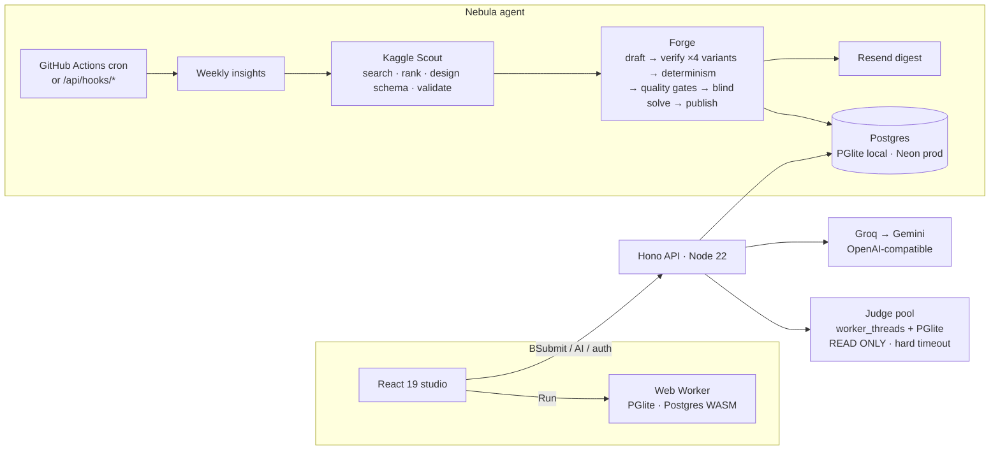

# ✦ Querion

**Master SQL on real data, judged like an interview.**

Querion is a PostgreSQL practice studio. Every week an AI agent (**Nebula**) pulls fresh datasets from Kaggle, designs a relational schema, and forges new problems. Each problem is verified on real Postgres, judged against hidden test data, and coached by an AI tutor that never hands over the answer. Everything runs on free tiers.


---

## Why Querion — the gaps it closes

| Gap in today's SQL practice sites | What Querion does |
|---|---|
| Static question banks that everyone has memorised | **Nebula** forges new problems daily and weekly from newly scouted Kaggle data |
| AI-generated questions with wrong answers | Expected outputs are **computed** on real Postgres and never written by a model. The reference must be deterministic, and a **second model blind-solves** the statement before it is published |
| "Matches the sample" ≠ correct | **Hidden test datasets** (shuffled storage, sparse data, ties & duplicates), like DSA judges |
| No notion of an *optimal* query | Accepted answers are compared to the reference **planner cost**. **Architect** problems fail with `INEFFICIENT` if you blow the cost budget |
| Hints that spoil the answer | A 3-step **hint ladder** (nudge → concept → skeleton) personalised to your query, with a token-overlap **leak guard** |
| Cryptic Postgres errors | Offline **error intelligence** ("Did you mean `full_name` (in drivers)?") plus an AI root-cause explanation |
| Flat lists of unrelated questions | Every dataset is a **track with 6 tiers**: Foundations → Aggregation → Relationships → Composition → Analytics → Architect |
| Slow server round-trips for every run | **PostgreSQL compiled to WebAssembly (PGlite)** runs in your browser, so runs are instant and private |
| Shared DB sandboxes (security risk) | Learner SQL runs only in throwaway in-memory PGlite instances inside worker threads, in `READ ONLY` transactions, with a tokenizer-based guard and hard kill on timeout |

## Feature tour

- **Studio**: resizable 3-pane IDE with CodeMirror 6, schema-aware autocomplete, Run (`Ctrl/⌘+Enter`, runs the selection or the whole query), Submit (`Ctrl/⌘+Shift+Enter`), Format (`Ctrl/⌘+S`), autosaved drafts, error-line highlighting, an interactive **ER diagram**, a result grid with CSV/TSV export, a row-level **diff** of expected vs your rows, and **EXPLAIN ANALYZE** as a cost-hotspot tree.
- **Judge**: 4 test cases per problem, verdicts `ACCEPTED · WRONG_ANSWER · RUNTIME_ERROR · TIME_LIMIT · REJECTED · INEFFICIENT`, with an efficiency comparison against the reference plan.
- **AI tutor**: personalised hint ladder, "Explain this error", "Why is this wrong?", a post-accept senior **code review**, and free-form questions. Groq first, Gemini 2.5 Flash fallback, curated offline fallback.
- **Learning paths**: tracks per dataset, a Daily Orbit, a weekly Constellation pack, recommendations ("Up next", "Strengthen your weakest topic"), streaks, a heatmap, and topic mastery.
- **Product UX**: command palette (`Ctrl/⌘+K`), persistent sidebar, keyboard shortcuts (`?`), YouTube-style top loader, skeletons, optimistic submits with rollback, undoable bulk actions, URL-synced filters, smart form validation, onboarding, referrals (`/invite/:handle`), destructive-action confirmations (type-to-confirm), error boundaries with retry, a custom 404, a mobile layout, and dark/light themes.

## Architecture



```
apps/
  api/                 Hono API, judge pool, AI tutor, Nebula agent, scheduler, CLIs
    src/nebula/        forge · scout · insights · recommend · scheduler · datasets/ (generators + Kaggle normalisers)
  web/                 React 19 + Vite 7 + Tailwind 4 + Motion + CodeMirror 6 + PGlite worker
packages/
  engine/              isomorphic core (browser + Node): SQL tokenizer/guard, dataset loader,
                       test-variant generator, result judge, runner, EXPLAIN, error intelligence
data/
  datasets/*.json      curated catalog (synthetic domains + normalised Kaggle slices)
  kaggle-catalog.json  datasets the agent may ingest
.github/workflows/nebula.yml   free scheduler (daily + Sunday weekly agent)
```

### The Nebula weekly agent (Sunday 18:00 UTC → published Monday)

1. **Insights**: per-learner outcomes from last week: solve rate per topic, hardest and abandoned problems, popular domains.
2. **Kaggle Scout**: searches a rotating domain and keeps open-license, well-rated, small CSV datasets that haven't been used yet. An LLM ranks them by *SQL-teachability*.
3. **Schema design**: the LLM writes a normalised 2–5 table schema as SQL over the raw CSV. It is **executed on Postgres** and validated (non-empty tables, unique PKs, FKs that resolve, at least one relationship). Errors go back to the model for repair.
4. **Forge a ladder**: one problem per tier (1→6) on the new dataset, plus *stepping-stone* problems for last week's weakest topics.
5. **Verify**: the reference runs on 4 data variants and on mirrored storage order, so non-deterministic answers are rejected. Quality gates check row counts, named columns, novelty and banned functions. A **second model blind-solves** the statement, and if it disagrees the statement gets rewritten.
6. **Publish & notify**: expected outputs are stored as computed. Opted-in users get a Resend digest.

Free-tier aware: providers that return 429 are benched (cooldown), and the calendar falls back to unused curated problems so it never has gaps.

## Quick start

Requirements: Node ≥ 22, pnpm 9 (`npm i -g pnpm`).

```bash
pnpm install
```

```bash
cp apps/api/.env.example apps/api/.env   # add your free GROQ_API_KEY (gsk_…) — Gemini is an optional backup
```

```bash
pnpm doctor   # checks Groq, Gemini, Kaggle, database, email and secrets with real requests
```

```bash
pnpm dev
```

Open http://localhost:5173. The API (port 8787) uses an **embedded Postgres (PGlite) stored in `.data/`**, so there is no database to install. On first boot it verifies and seeds the curated problem bank.

Useful scripts:

| Command | What it does |
|---|---|
| `pnpm doctor` | test every key/connection (each AI model, Kaggle search + download, Neon, Resend, secrets) |
| `pnpm mail:test you@mail.com all` | send every email (test, welcome, reset, changed, weekly) through Resend and print Resend's real response |
| `pnpm test` | engine tests + API integration tests (auth, judge, security limits, AI fallback) |
| `pnpm --filter @querion/api exec tsx src/cli/check.ts` | re-verify every curated problem on Postgres + tier calibration |
| `pnpm forge -- --pack --dataset shipfast` | forge an Easy / Medium / Hard pack for one segment (or `--domain transport`) |
| `pnpm forge -- --one --dataset transit --tier 5` | forge one problem and print every verification step |
| `pnpm --filter @querion/api exec tsx src/cli/nebula.ts scout transport` | scout Kaggle for a fresh dataset in a segment |
| `pnpm --filter @querion/api exec tsx src/cli/nebula.ts weekly` | run the full weekly agent now |
| `pnpm datasets:build` | rebuild curated dataset JSON (synthetic + Kaggle normalisers) |

### AI setup (Groq first)

`GROQ_MODEL=openai/gpt-oss-120b` drafts problems. Other Groq models (`qwen/qwen3.8-27b`, `openai/gpt-oss-20b`) blind-solve and review them, so a *different model family* always checks the work. Gemini (`GEMINI_MODELS`) is an optional backup; set `AI_PROVIDERS=groq` to never call it. Models a key doesn't have are skipped automatically. Rate-limited models cool down while the next one takes over, and Groq's short per-minute limits are waited out instead of falling back.

### Forge quality gates

Every AI problem must pass, in order: Postgres execution on 4 data variants, a determinism check, quality rules (row counts, named columns, novelty, no `NOW()`), **tier calibration** (the reference must really use that tier's skills), a **blind solve** by another model from the statement alone (wrong answer means the statement gets rewritten), and an **editor rubric** (clarity, realism, difficulty fit, teaching value; overall ≥ 7). Two hand-written curated problems are shown to the model as the house standard.

### Email (Resend)

| Email | Sent when |
|---|---|
| Welcome | right after sign-up |
| Password reset | `/forgot-password` (single-use link, 30 min) |
| Password changed | after a reset or a change in Settings (security alert) |
| Weekly pack | Sunday weekly run, to users with weekly emails on (one-click unsubscribe) |

Set `RESEND_API_KEY` (a "sending access" key is enough). **Important:** while `MAIL_FROM` uses `onboarding@resend.dev`, Resend delivers **only to your own Resend account email**. To email real users, add a domain at [resend.com/domains](https://resend.com/domains), add its DNS records, then set `MAIL_FROM="Querion <no-reply@your-domain>"`. Set `APP_URL` to your live site so links in emails work. Failures are logged with Resend's actual error message. In dev, if a reset email can't be delivered, the link is printed in the API console.

### Design system

One theme, **Cobalt Observatory**: Swiss grid + editorial type (Geist + *Instrument Serif* accents) + aurora light. Colour rule: **black + cobalt do 90% of the work; acid lime is reserved for the one action we want pressed** (Solve / Run / Submit) and the logo's "answer" star. Status colours are muted so they never compete.

### Security

Strict CSP (only `'wasm-unsafe-eval'` for in-browser Postgres), HSTS, `frame-ancestors 'none'`. JWT pinned to HS256 with issuer and audience. Login takes equal time whether or not the account exists. Rate limits apply per identity **and** per IP. 64 KB body limit. Constant-time admin/cron secret checks. Learner SQL runs only in throwaway PGlite workers, read-only, with a hard timeout.

## Deploy for $0

| Piece | Free service |
|---|---|
| Web + API (one service) | **Render** free web service (`render.yaml`) — or Koyeb / Fly |
| Database | **Neon** free Postgres → `DB_DRIVER=postgres`, `DATABASE_URL=…` |
| Scheduling | **GitHub Actions** (`.github/workflows/nebula.yml`) — works while the web host sleeps. Any other cron (n8n, cron-job.org) can call `POST /api/hooks/daily` or `/api/hooks/weekly` with `x-cron-secret` |
| Web (static) | **Cloudflare Pages** with root directory `apps/web`, build `pnpm build`, output `dist`. Env: `VITE_SITE_URL` (your site URL), `API_ORIGIN` (your Render URL) and `PROXY_SECRET`. The Pages Function in `apps/web/functions/api/[[path]].ts` serves `/api/*` on your own domain, so the session cookie is first-party. Leave `VITE_API_URL` unset. |
| AI | **Groq** free tier (primary) · Gemini free tier optional backup |
| Data | **Kaggle API** (free account token) |
| Email | **Resend** free tier (3,000/month) |

Set the same secrets in GitHub (Settings → Secrets → Actions) and in Render: `DATABASE_URL`, `GROQ_API_KEY` / `GEMINI_API_KEY`, `KAGGLE_USERNAME`, `KAGGLE_KEY`, `RESEND_API_KEY`, `APP_URL`, `JWT_SECRET`, `CRON_SECRET`. On Render also set `CORS_ORIGIN` = your site URL and `PROXY_SECRET` (same value as in Pages).

### Accounts & sessions

- **Flow:** public landing → `/signup` or `/login` → `/dashboard`. Every app page (`/dashboard`, `/problems`, `/p/:slug`, `/me`, `/settings`) requires a session; signed-out visitors are sent to `/login?next=…` and returned afterwards. Only same-site paths are accepted for `next`.
- **Sessions:** an opaque 256-bit token in an **httpOnly** cookie that JavaScript can't read (`__Host-qn_session` in production: Secure, `SameSite=Lax`). The database stores only an HMAC of the token. Sessions expire after 30 days idle (90 days absolute) and can be revoked one by one, all except the current one, or automatically on password change.
- **CSRF:** every state-changing request must carry `X-Querion-CSRF` and come from an allowed Origin.
- **Passwords:** bcrypt (cost 12), with a policy against common passwords and passwords containing your handle or email. Logins take equal time whether or not the account exists, and an account locks for 15 minutes after 8 failed attempts.
- **Reset:** a single-use, hashed, 30-minute token sent by email (printed to the server console in dev when email isn't configured). Resetting signs out every device.

## Tech stack

TypeScript everywhere · **React 19**, **Vite 7**, **Tailwind CSS 4**, **Motion**, **TanStack Query 5**, **Zustand 5**, **CodeMirror 6**, **React Flow 12**, **react-resizable-panels** · **Hono 4** on Node 22, **Zod 4**, httpOnly cookie sessions · **PGlite 0.5** (Postgres 17 in WASM) in browser, judge workers and local dev · **Neon** Postgres in production · **Groq** and **Gemini** via their OpenAI-compatible endpoints · **Kaggle API** · **Resend** · **GitHub Actions**.

## Data & licenses

Synthetic datasets (transit, autohaus, shipfast, carepoint, shopwave) are generated deterministically and released under CC0. Kaggle datasets keep their original open licenses and link to their sources. Netflix titles: CC0. Olympics: CC0.
